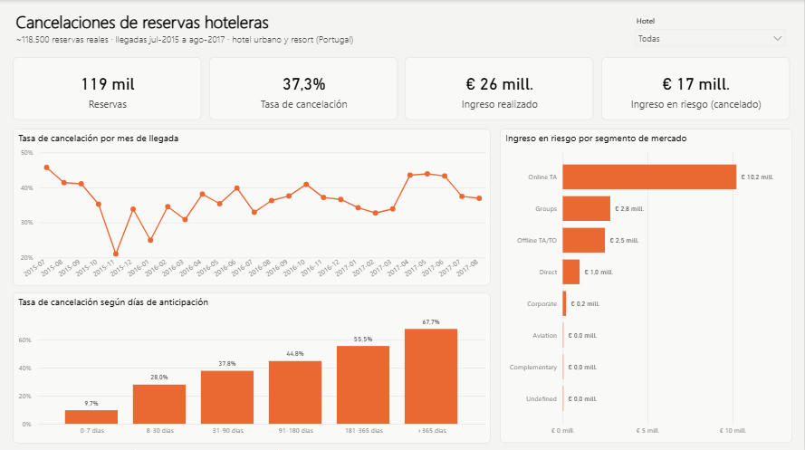
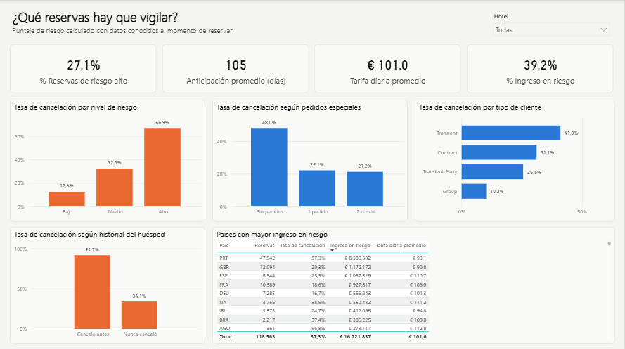
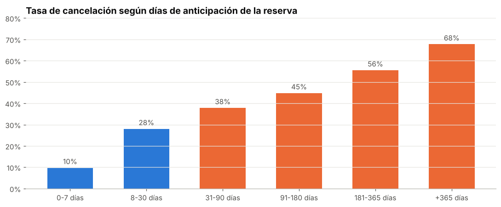
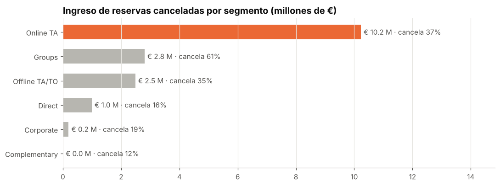
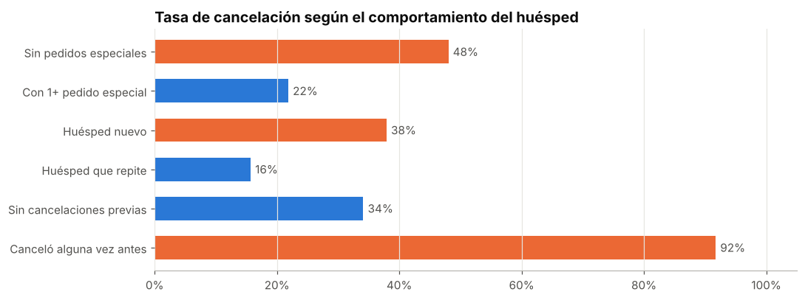
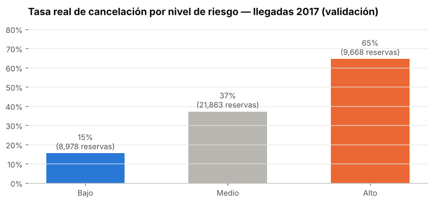

# ¿Cuánto ingreso se pierde por cancelaciones y qué reservas hay que vigilar?

**Análisis de ~118.500 reservas hoteleras reales** de un hotel urbano y un resort en Portugal (llegadas de jul-2015 a ago-2017).

`Python (Pandas)` · `SQL (CTEs, funciones de ventana)` · `Power BI (DAX, Power Query)` · `Jupyter`

---

## Resumen ejecutivo

**37% de las reservas se cancela.** Esas reservas valían **€ 16,7 M**, el equivalente al **64% de lo que el hotel efectivamente facturó** (€ 26,0 M). Busqué qué tienen en común las reservas que se caen y si se pueden detectar **el mismo día en que se hacen**.

| Hallazgo | Dato |
|---|---|
| Cuanto más anticipada la reserva, más se cancela | 0-7 días: 10% · más de 6 meses: 56-68% |
| Las **agencias online** concentran el **61% del ingreso cancelado** | la venta directa cancela 15% |
| El huésped sin pedidos especiales cancela **más del doble** | 48% vs 22% |
| Quien ya canceló alguna vez **vuelve a cancelar el 92%** de las veces | |
| El hotel urbano cancela mucho más que el resort | 42% vs 28% |

### Puntaje de riesgo validado con datos nuevos

Armé un puntaje simple (0 a 7 puntos) usando **solo información disponible al momento de reservar**: anticipación, canal, pedidos especiales, cancelaciones previas y si el huésped repite. Las reglas se definieron mirando 2015-2016 y se **validaron sobre las llegadas de 2017**:

| Nivel de riesgo | Reservas 2017 | Tasa real de cancelación |
|---|---|---|
| Bajo (0-2) | 8.978 | **15%** |
| Medio (3-4) | 21.863 | 37% |
| Alto (5+) | 9.668 | **65%** |

Una reserva de riesgo alto cancela **4,2 veces más** que una de riesgo bajo. Son reglas que recepción o revenue management pueden aplicar sin un modelo complejo.

**Impacto estimado:** en 2016 hubo 15.226 reservas de riesgo alto. Cada 10 puntos porcentuales menos de cancelación en ese grupo (con depósito parcial o reconfirmación) protegen **~€ 500 mil por año**.

## Recomendaciones

1. **Depósito parcial o reconfirmación obligatoria** para reservas de riesgo alto o con más de 90 días de anticipación.
2. **Incentivar la reserva directa** (mejor tarifa o beneficio): cancela menos de la mitad que las agencias online.
3. **Sobreventa controlada solo sobre reservas de riesgo alto**, en los meses de mayor demanda.
4. **Seguir la tasa de cancelación y el ingreso en riesgo como KPI mensual**, por hotel y canal.

---

## Tablero en Power BI

Dos páginas: **Resumen de cancelaciones** (reservas, tasa de cancelación, ingreso realizado y en riesgo, evolución mensual, anticipación, segmentos) y **Riesgo de cancelación** (niveles de riesgo, pedidos especiales, tipo de cliente, historial del huésped y países). Se puede filtrar por hotel.





📥 **[Descargar el tablero (.pbix)](powerbi/Hotel_Cancelaciones.pbix)**: se abre con Power BI Desktop y ya incluye los datos.

**Modelo:** `bookings` (hechos, 1 fila por reserva) · `Calendario` (tabla de fechas en DAX) · `_Medidas` (tabla de medidas).

<details>
<summary><b>Medidas DAX principales</b></summary>

```dax
Tasa de cancelación = DIVIDE([Reservas canceladas], [Reservas])

Ingreso realizado = CALCULATE(SUM(bookings[revenue]), bookings[is_canceled] = 0)

Ingreso en riesgo = CALCULATE(SUM(bookings[revenue]), bookings[is_canceled] = 1)

% Ingreso en riesgo = DIVIDE([Ingreso en riesgo], [Ingreso realizado] + [Ingreso en riesgo])

% Reservas riesgo alto = DIVIDE(CALCULATE([Reservas], bookings[risk_level] = "Alto"), [Reservas])
```
</details>

## Análisis

| | |
|---|---|
|  |  |
|  |  |

El análisis completo, con cada gráfico y su lectura, está en [`notebooks/analisis_exploratorio.ipynb`](notebooks/analisis_exploratorio.ipynb).

## SQL

[`sql/analysis.sql`](sql/analysis.sql) tiene 7 consultas de negocio. Por ejemplo, la validación del puntaje de riesgo sobre 2017:

```sql
SELECT risk_level                                   AS nivel_riesgo,
       COUNT(*)                                     AS reservas_2017,
       ROUND(100.0 * AVG(is_canceled), 1)           AS tasa_cancelacion_pct,
       ROUND(100.0 * SUM(is_canceled) / SUM(SUM(is_canceled)) OVER (), 1) AS pct_de_todas_las_cancelaciones
FROM bookings
WHERE arrival_date_year = 2017
GROUP BY risk_level
ORDER BY tasa_cancelacion_pct;
```

Resultados de todas las consultas: [`reports/resultados_sql.md`](reports/resultados_sql.md).

## Datos y limpieza

**Fuente:** [Hotel Booking Demand](https://www.kaggle.com/datasets/jessemostipak/hotel-booking-demand) (Kaggle), publicado originalmente por Antonio, Almeida y Nunes (2019), *Data in Brief*. Datos reales anonimizados.

Decisiones principales (detalle en [`reports/calidad_de_datos.md`](reports/calidad_de_datos.md)):

- **Registros inválidos eliminados (827, 0,7%):** reservas sin huéspedes, con 0 noches, con tarifa negativa o con un outlier de € 5.400 por noche.
- **Duplicados conservados:** el dataset no tiene ID de reserva y las reservas grupales generan filas idénticas legítimas.
- **Sin fuga de información:** `reservation_status` y `assigned_room_type` se conocen *después* del resultado, por eso no se usan para segmentar el riesgo.
- **Anomalía detectada:** las reservas con depósito *no reembolsable* figuran canceladas en un 99%, algo que contradice la lógica del negocio y probablemente sea un error de registro. Se reporta, pero no se usa para concluir.
- **Estacionalidad:** solo 2016 es un año completo; para comparar meses uso ese año.

**Limitaciones:** son dos hoteles de un mismo país; el ingreso cancelado es bruto, porque parte de esas noches se revende.

## Estructura

```
├── data/powerbi/         CSV que consume el tablero
├── notebooks/            Análisis exploratorio con conclusiones
├── powerbi/              Tablero (.pbix) y proyecto Power BI (.pbip): modelo, medidas DAX y reporte
├── reports/              Calidad de datos, resultados SQL y gráficos
├── sql/analysis.sql      Consultas de negocio
└── src/
    ├── clean.py          Limpieza, validación, variables de negocio y puntaje de riesgo
    ├── run_sql.py        Carga en SQLite y ejecución de las consultas
    └── export_powerbi.py Exportación del CSV para Power BI
```

## Cómo reproducirlo

```bash
pip install -r requirements.txt
# 1. Descargar hotel_bookings.csv de Kaggle en data/raw/
python src/clean.py
python src/run_sql.py
python src/export_powerbi.py
jupyter notebook notebooks/analisis_exploratorio.ipynb
```

**Power BI:** `powerbi/Hotel_Cancelaciones.pbix` se abre directo con los datos incluidos. Para editar el proyecto en formato texto (control de versiones), abrir `powerbi/Hotel_Cancelaciones.pbip` con Power BI Desktop. Si la carpeta del proyecto está en otra ruta, actualizar el parámetro `CarpetaDatos` (Transformar datos → Administrar parámetros) para que apunte a `data/powerbi/` y luego **Actualizar**.

---

**Gastón Szylak** · Analista de Datos · [LinkedIn](https://www.linkedin.com/in/gastonszylak) · [GitHub](https://github.com/gastonszylak)
